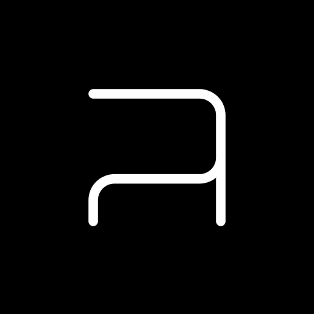

# ORCΛ SEΛFLΛKE



Orca Seaflake is a modified desktop build of [Orca](https://github.com/hundredrabbits/Orca), the esoteric programming language for quickly creating procedural sequencers. Each letter is an operation: lowercase operators run on bang, while uppercase operators run each frame.

Orca Seaflake is a **livecoding environment**, not a synthesizer. It sends MIDI, OSC, and UDP to audio and visual software or hardware, and includes probability, phase, burst, tuned-note, binary-scale, and shaped MIDI-sequence operators.

- [Download installers](https://github.com/femifleming/orca_seaflake/releases/latest) for **macOS, Windows, Linux, Debian/Ubuntu, and 64-bit Raspberry Pi OS**.
- [Run from source](#install--run), using Node.js and npm.
- The desktop app follows upstream Orca's layout: application code, Electron entry point, and desktop packaging metadata live in [`desktop/`](desktop/).
- Read the [operator guide](docs/OPERATORS.md) for operand positions, defaults, ranges, examples, and triggering behavior.
- Read the [packaging guide](docs/PACKAGING.md) to create packages locally.

## Install & Run

### Install with Homebrew

On macOS, install Orca Seaflake with one command:

```sh
brew install --cask femifleming/orca_seaflake/orca-seaflake
```

Homebrew automatically adds the [Orca Seaflake Cask tap](https://github.com/femifleming/homebrew-orca_seaflake) when needed; you do not need to run `brew tap` separately.

The app is ad-hoc signed, not Developer ID signed or notarized, so macOS may ask you to approve it once on first launch: Control-click it, choose **Open**, then confirm, or use **System Settings → Privacy & Security → Open Anyway**.

### Download a packaged build

Open the [latest release](https://github.com/femifleming/orca_seaflake/releases/latest) and pick the file for your system from the table below. Replace `0.1.4` with the current version. In file names, `darwin` means macOS, `win32` means 64-bit Windows, `x64`/`amd64` means an Intel/AMD processor, and `arm64` means Apple Silicon or ARM.

| Your system | Download | File name |
| --- | --- | --- |
| macOS, Apple Silicon (M1 or newer) | `.pkg` installer, or `.zip` app | `Orca-Seaflake-0.1.4-darwin-arm64.pkg` / `.zip` |
| macOS, Intel | `.pkg` installer, or `.zip` app | `Orca-Seaflake-0.1.4-darwin-x64.pkg` / `.zip` |
| Windows 10/11, 64-bit | `.zip` | `Orca-Seaflake-0.1.4-win32-x64.zip` |
| Debian / Ubuntu, Intel/AMD | `.deb` | `orca-seaflake_0.1.4_amd64.deb` |
| Debian / Ubuntu, ARM64, or 64-bit Raspberry Pi OS | `.deb` | `orca-seaflake_0.1.4_arm64.deb` |
| Other Linux, Intel/AMD | `.tar.gz` | `Orca-Seaflake-0.1.4-linux-x64.tar.gz` |
| Other Linux, ARM64, or 64-bit Raspberry Pi OS | `.tar.gz` | `Orca-Seaflake-0.1.4-linux-arm64.tar.gz` |

Files without a version number (for example `Orca-Seaflake-darwin-arm64.zip`) are copies used by Homebrew; ignore them. 32-bit Raspberry Pi OS is not supported. Linux builds need a graphical desktop and MIDI/ALSA libraries; see [Linux packaging notes](https://github.com/femifleming/orca_seaflake/blob/main/docs/PACKAGING.md#platform-notes).

### Install steps by system

**macOS:** double-click the `.pkg` and follow the prompts; it installs Orca Seaflake into Applications. Or open the `.zip` and drag the app into Applications. The app is not notarized by Apple, so macOS may block the first launch. Control-click the app (or installer), choose **Open**, then confirm; or go to **System Settings → Privacy & Security → Open Anyway**.

**Windows:** right-click the `.zip`, choose **Extract All**, open the extracted folder, and run `orca-seaflake.exe`. The build is unsigned, so if SmartScreen appears choose **More info → Run anyway**.

**Debian, Ubuntu, and 64-bit Raspberry Pi OS:** open the `.deb` with your software installer, or run this in a terminal from the folder containing the download (use the `arm64` file on ARM):

```
sudo apt install ./orca-seaflake_0.1.4_amd64.deb
```

Then launch **Orca Seaflake** from your application menu or run `orca-seaflake`.

**Other 64-bit Linux:** extract the `.tar.gz`, open a terminal in the extracted `Orca-Seaflake-linux-x64` (or `-arm64`) folder, and run `./orca-seaflake`. If it does not start, install the GTK 3, NSS, X11 screen-saver (libXss), ALSA, and GBM libraries from your distribution.

### Run from source

Install [Node.js](https://nodejs.org/) 18 or newer, then run these commands from a terminal:

```sh
git clone https://github.com/femifleming/orca_seaflake.git
cd orca_seaflake
cd desktop
npm ci
npm start
```

Choose a MIDI output with **MIDI → Next Output Device** (`Cmd/Ctrl+.`); refresh devices with `Cmd/Ctrl+Shift+M`. Set OSC and UDP destinations in **Communication**. Press `Cmd/Ctrl+G` to show the operator guide or `Cmd/Ctrl+K` to open the command prompt.

## Operators

The full operator list is available in the built-in guide with `Cmd/Ctrl+G`. Seaflake adds:

- `^` **probability**: passes a bang according to its probability operands.
- `&` **phase clock**: emits a phase-based clock pulse.
- `~` **timed burst**: emits a timed series of bangs.
- `(` **just intonation**: sends tuned MIDI notes.
- `)` **binary scale note**: selects notes from the active binary scale.
- `+` **binary scale**: defines the scale used by `)`.
- `@` **shaped MIDI sequence**: controls channel, octave, note, velocity, envelope, repeats, duration, and pulse width.

Existing Orca operators and the Seaflake IO/MIDI operators are documented in the [operator reference](docs/OPERATORS.md), including operand order, valid values, defaults, and working patterns.

### IO

- `:` **midi**: sends MIDI notes.
- `%` **mono**: sends monophonic MIDI notes.
- `!` **cc**: sends MIDI control change.
- `?` **pitch bend**: sends MIDI pitch-bend values.
- `=` **osc**: sends OSC messages.
- `;` **udp**: sends UDP messages.
- `$` **self**: sends an Orca command.

See the operator guide for exact inputs and examples for these operators. On Linux layouts where Shift+4 is reported as the unshifted `4` key, the grid converts Shift+4 to `$` so the self operator remains typeable.

## Companion Applications

Orca Seaflake can send MIDI, OSC, and UDP to compatible applications and hardware, including:

- [Pilot](https://github.com/hundredrabbits/pilot), a companion synth tool.
- [Aioi](https://github.com/MAKIO135/aioi), for complex OSC messages.
- [Sonic Pi](https://sonic-pi.net/), a livecoding environment.
- Any MIDI, OSC, or UDP receiver configured for the selected destination ports.

## Links

- [Original Orca](https://github.com/hundredrabbits/Orca)
- [Latest release and downloads](https://github.com/femifleming/orca_seaflake/releases/latest)
- [Operator reference](docs/OPERATORS.md)
- [Packaging guide](docs/PACKAGING.md)

## Extras

- Orca Seaflake is derived from [Hundred Rabbits' Orca](https://github.com/hundredrabbits/Orca).
- See [LICENSE.md](LICENSE.md) for license rights and limitations (MIT).
- Contributions are welcome.
