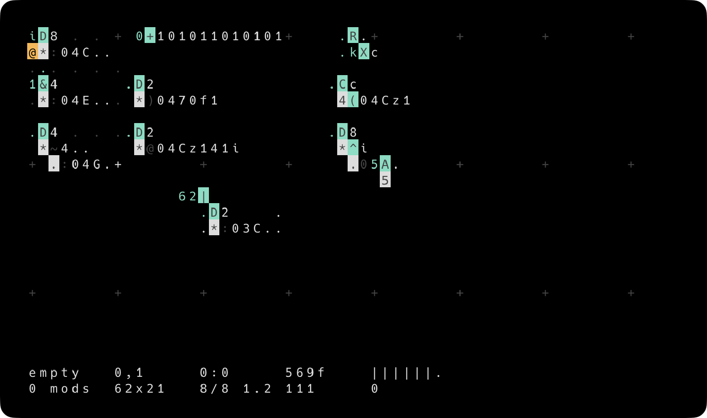
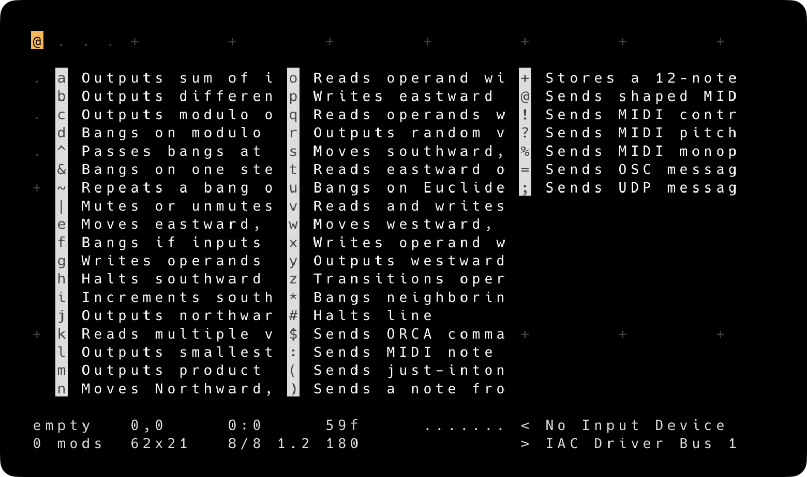
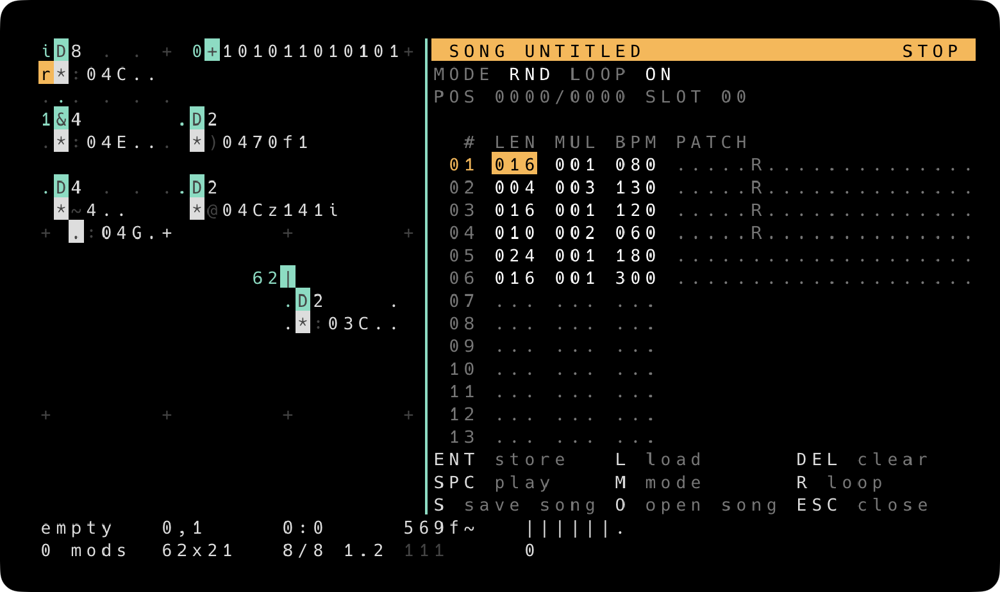
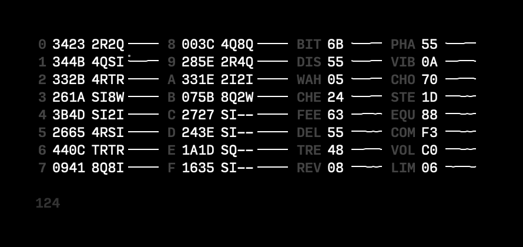
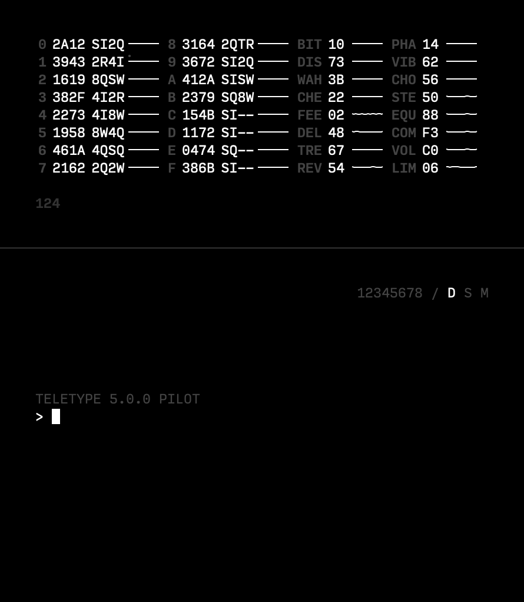

# contents

@toc

# 1. what it is

Orca Seaflake is a version of [Orca](https://github.com/hundredrabbits/Orca), the esoteric programming language by Hundred Rabbits for building procedural sequencers. The whole program is a grid of characters. Every letter of the alphabet is an operation: uppercase letters run on every frame of the clock, lowercase letters run when a bang (`*`) lands next to them. Numbers and letters next to an operator are its inputs; what it computes appears in the cell below it, where the next operator reads it. A patch is a plain text file you can read and write by hand.

**It is not a synthesizer.** It is a live-coding environment that sends MIDI, OSC and UDP to whatever makes the sound: Ableton, Renoise, VCV Rack, SuperCollider, a hardware synth, or Pilot Sealflake, the synth in this same download that listens to Orca's `;` operator with no set-up at all.



Seaflake keeps every original Orca operator exactly as it is in the released Orca app, defaults included, so patches made for Orca play the same. It adds:

- **New operators** for probability (`^`), phase clocks (`&`), timed bursts (`~`), muting blocks (`|`), scales (`+` and `)`), just intonation (`(`) and shaped note runs (`@`).
- **Song Mode**, a 32-slot arranger that chains patches together at 16th-note resolution and saves them as `.song` files.
- **A terminal version** that runs in Terminal, Windows Terminal or over SSH on a Raspberry Pi.
- **Settings** for the background colour, window transparency and font.
- **Pilot Sealflake**, a rewrite of Hundred Rabbits' Pilot with new engines and effects, monome Teletype built in and a Just Friends engine, as a standalone app and as VST3 / AU / LV2 plug-ins.

# 2. installing

## the desktop app

Download the file for your computer from **github.com/femifleming/orca_seaflake/releases/latest**, then follow the step next to it.

| Your computer | Download | Then |
| --- | --- | --- |
| Mac with Apple Silicon (M1, M2, M3, M4…) | `Orca-Seaflake-darwin-arm64.pkg` | Double-click it and follow the installer. |
| Mac with an Intel processor | `Orca-Seaflake-darwin-x64.pkg` | Double-click it and follow the installer. |
| Windows 10 or 11 (64-bit) | `Orca-Seaflake-win32-x64.zip` | Right-click → **Extract All**, open the folder, run `orca-seaflake.exe`. |
| Ubuntu / Debian (Intel or AMD) | `orca-seaflake_amd64.deb` | `sudo apt install ./orca-seaflake_amd64.deb` |
| Raspberry Pi OS **64-bit** (Pi 3, 4, 5), Ubuntu / Debian on ARM | `orca-seaflake_arm64.deb` | `sudo apt install ./orca-seaflake_arm64.deb` |
| Other Linux (Intel/AMD or ARM64) | `Orca-Seaflake-linux-x64.tar.gz` · `Orca-Seaflake-linux-arm64.tar.gz` | Extract it and run `./orca-seaflake` inside the folder. |

Then open **Orca Seaflake** from Applications (macOS), the extracted folder (Windows), or your app menu / the `orca-seaflake` command (Linux).

On a Mac you can also install with Homebrew, from the one tap that holds all of femifleming's apps, and update later with `brew upgrade`:

```sh
brew tap femifleming/tap && brew trust --tap femifleming/tap
brew install --cask femifleming/tap/orca-seaflake
```

**Not sure which one you need?**

- **Mac:** Apple menu → **About This Mac**. "Chip: Apple M…" means Apple Silicon; "Processor: Intel" means Intel.
- **Raspberry Pi:** run `uname -m` in a terminal. `aarch64` means 64-bit; `armv7l` or `armv6l` means 32-bit. The desktop app needs 64-bit (Pi 3, 4 or 5), so on 32-bit Raspberry Pi OS use the terminal version.

**First launch:** the app isn't signed with a paid Apple or Microsoft certificate, so your computer may warn you once.

- **macOS** says it "cannot verify the developer": open **System Settings → Privacy & Security**, scroll down and click **Open Anyway**. Or Control-click the app, choose **Open**, then **Open** again. The Homebrew cask clears the quarantine for you.
- **Windows** shows "Windows protected your PC": click **More info → Run anyway**.

## the terminal version

The terminal version runs the same operators and Song Mode without a window. On a Mac with Homebrew, one command installs it, Node.js included:

```sh
brew install femifleming/tap/orca-seaflake-terminal
```

Otherwise install Node.js LTS (nodejs.org; on Raspberry Pi OS, Ubuntu and Debian `sudo apt install -y nodejs npm alsa-utils`), then:

```sh
npm install -g https://github.com/femifleming/orca_seaflake/releases/latest/download/orca-seaflake-terminal.tgz
```

(on Linux and Raspberry Pi, put `sudo` in front) and run it with `orca-seaflake`. Chapter 7 has the details.

## pilot sealflake

The synth that answers Orca's `;` operator. It downloads and installs on its own; take either one, or both.

| Your computer | Download | Then |
| --- | --- | --- |
| Mac (Apple Silicon or Intel) | `Pilot-Sealflake-macos.pkg` | Double-click it: installs the app, the VST3 and the AU. |
| Mac, without an installer | `Pilot-Sealflake-macos.zip` | Drag the app to Applications; plug-ins go in `~/Library/Audio/Plug-Ins/VST3` and `Components`. |
| Windows 10 or 11 (64-bit) | `Pilot-Sealflake-windows-x64.zip` | Extract it, run `Pilot Sealflake.exe`. Copy `Pilot Sealflake.vst3` to `C:\Program Files\Common Files\VST3` for your DAW. |
| Ubuntu / Debian (Intel or AMD) | `pilot-sealflake_amd64.deb` | `sudo apt install ./pilot-sealflake_amd64.deb`, then run `pilot-sealflake` (VST3 and LV2 included). |
| Raspberry Pi OS 64-bit, Ubuntu / Debian on ARM | `pilot-sealflake_arm64.deb` | `sudo apt install ./pilot-sealflake_arm64.deb` |
| Other Linux | `Pilot-Sealflake-linux-x64.tar.gz` · `Pilot-Sealflake-linux-arm64.tar.gz` | Extract it and run `./install.sh` (installs for your user), or run `./pilot-sealflake` in place. |

With Homebrew on a Mac (or Homebrew on Linux, and Scoop on Windows):

```sh
brew install --cask femifleming/tap/pilot-sealflake       # macOS: app + VST3 + AU
brew install --formula femifleming/tap/pilot-sealflake    # Linux
scoop bucket add femifleming https://github.com/femifleming/homebrew-tap
scoop install femifleming/pilot-sealflake                 # Windows
```

Start Pilot Sealflake, then in Orca write `;` with a Pilot command, for example `;04C` (channel 0, octave 4, C). Chapter 8 has everything Pilot understands.

## run from source

Install Node.js 18 or newer, then:

```sh
git clone https://github.com/femifleming/orca_seaflake.git
cd orca_seaflake/desktop
npm install
npm start
```

For the terminal version from source, run `npm install` and then `npm link` in the `terminal` folder instead. Pilot Sealflake builds with CMake (`cmake -B build -G Ninja -DCMAKE_BUILD_TYPE=Release && cmake --build build` in `pilot/`); the packaging scripts are described in `docs/PACKAGING.md`.

# 3. connecting it to a synth

Orca Seaflake sends MIDI notes out; something else makes the sound. Plug in a MIDI device, or create a virtual MIDI port to reach software like Ableton, VCV Rack or GarageBand:

| System | Virtual MIDI port |
| --- | --- |
| macOS | Open **Audio MIDI Setup** → **Window → Show MIDI Studio** → double-click **IAC Driver** → tick **Device is online**. |
| Windows | Install loopMIDI (tobias-erichsen.de/software/loopmidi.html) and click **+** to create a port. |
| Linux / Raspberry Pi | A USB MIDI device appears automatically. `aconnect -l` lists ports; `sudo modprobe snd-virmidi` adds virtual ones. |

Or skip MIDI: Pilot Sealflake is a synth that listens to Orca's `;` operator directly (UDP port 49161), no set-up needed.

Then choose the output. In the **desktop app**, press `Cmd+.` (`Ctrl+.` on Windows and Linux) until your device shows at the bottom right of the window; **MIDI → Refresh Devices** (`Cmd/Ctrl+Shift+M`) rescans MIDI hardware. In the **terminal version**, press `Ctrl+K`, type `midi: -1` and press Enter to list outputs, then use `midi: 2` to pick output 2.

The simplest test: type `D8` anywhere, then `:04C` on the row below with the `:` right under the `D`, and press `Space`. `D8` bangs every eighth frame; `:04C` plays a C on octave 4 through MIDI channel 1 (channels count from `0`). The frame counter in the footer runs, and your synth should sound.

# 4. the grid

## the window

The grid starts empty, with a `+` every eighth cell to help you count. The cursor is the highlighted `@`. Type any operator or value to write it at the cursor, `.` or `Backspace` to erase it. The footer shows, left to right: the file name, the cursor position, the frame and the tempo (`120f`), the eight-step bar indicator, and the MIDI input and output devices.



## controls

| Action | Desktop app | Terminal |
| --- | --- | --- |
| Play / pause | `Space` | `Space` |
| Tempo up / down | `>` / `<` | `>` / `<` |
| Leap 8 cells | `Cmd/Ctrl+Arrow` | `Shift`, `Option`/`Alt` or `Ctrl` + arrow |
| Save | `Cmd/Ctrl+S` | `Ctrl+S` |
| Open | `Cmd/Ctrl+O` | `Ctrl+O` |
| New | `Cmd/Ctrl+N` | `Ctrl+N` |
| Command prompt | `Cmd/Ctrl+K` | `Ctrl+K` |
| Operator guide | `Cmd/Ctrl+G` | — |
| Settings (background colour, transparency, font) | `Cmd/Ctrl+Shift+P` | — |
| Choose MIDI output | `Cmd/Ctrl+.` | `Ctrl+K` then `midi: 1` |
| Song Mode | `Cmd/Ctrl+T` | `Ctrl+T` |
| Undo / redo | `Cmd/Ctrl+Z` / `Cmd/Ctrl+Shift+Z` | `Ctrl+Z` / `Ctrl+Y` |
| Quit | `Cmd/Ctrl+Q` or close the window | `Ctrl+Q` |

The desktop app's full list is in its menus. `Cmd/Ctrl+P` triggers the operator at the cursor by hand, and `Cmd/Ctrl+F` advances one frame while paused. Selecting works as in Orca: `Shift` + arrows grows a selection, `Cmd/Ctrl+C` copies it, `Cmd/Ctrl+V` pastes a block (multi-line text from anywhere) at the cursor, `Cmd/Ctrl+X` cuts it.

## the command prompt

`Cmd/Ctrl+K` opens the command prompt at the bottom of the window. It accepts Orca's commands, and Seaflake's song commands:

| Command | Does |
| --- | --- |
| `bpm:140` | Set the tempo |
| `apm:30` | Set the tempo in quarter notes (`30` = 120 BPM) |
| `frame:0` | Jump to frame 0 |
| `skip:16` / `rewind:16` | Move forward / back 16 frames |
| `play` / `stop` / `run` | Transport |
| `color:` · `find:` · `select:` · `inject:` · `write:` · `copy` · `paste` · `erase` | Orca's other commands, as in the original |
| `midi:2` · `ip:` · `osc:49162` · `udp:49161` | Pick a MIDI output; the IP, OSC port and UDP port messages go to |
| `song` / `song:toggle` | Show or hide Song Mode |
| `song:play` · `song:stop` · `song:mode` · `song:save` · `song:open` | Song Mode from the prompt |

The same commands can be written into the grid with the `$` operator: `$bpm:140` next to a bang sets the tempo while the patch runs (`$bpm140` without the colon works too).

## settings

Open **Settings…** from the app menu (macOS) or the File menu (Windows and Linux), or press `Cmd/Ctrl+Shift+P`, to change:

- **Background colour**: any colour; the rest of the theme stays the same.
- **Background opacity**: lower it to see your desktop through the window while the grid text stays solid (macOS only).
- **Font**: Input Mono (the default) or any monospace font installed on your computer. Only installed fonts appear in the list; type any other installed font's name into **Other installed font**.

Settings are saved and come back the next time you open the app. **Reset to defaults** puts all three back.

## files

- **`.orca` patches** are plain text and identical to Orca's: they open in Orca, Seaflake and Seaflake's terminal version. Patches that use Seaflake's new operators need Seaflake to play them. `Cmd/Ctrl+O` opens one, `Cmd/Ctrl+S` saves; you can also drag a file onto the window.
- **`.song` files** are plain JSON and open in both Seaflake apps (chapter 6).
- The example patches in the repository's `patches/` folder are a good place to start: `orcaDronePulse1.orca` is a small patch with random (`R`), write (`X`) and increment (`I`); `orcaforMWM23rd.orca` is a 60-row patch.


# 5. operators

Orca is a two-dimensional grid sequencer. Place an operator glyph in the grid and put its operands in the cells around it. Most operators read a value to their left and right and write below; the tables in this chapter give the exact positions for each operator. A `.` input uses the documented default when one exists. The original Orca operators (A–Z and `* # : % ! ? = ; $`) behave exactly as in the classic Hundred Rabbits Orca app, including its defaults: a lone `D` bangs every 8 frames, a lone `C` counts 0–7, a lone `I` counts up by 1 and a lone `U` plays 1 of 8. Any other empty input reads as `0`, except where a minimum or default is listed.

@include docs/OPERATORS.md from "## Values and triggering" to "## Seaflake operators"

## base 36

Orca operates on a base of **36 increments**. Operators using numeric values also operate on letters and convert them into values as per the following table. For instance `Do` bangs every *24th frame*. Lowercase and uppercase letters are the same value as inputs; as note names, lowercase letters are sharps (`c` is C♯).

| **0** | **1** | **2** | **3** | **4** | **5** | **6** | **7** | **8** | **9** | **A** | **B** |
| :-: | :-: | :-: | :-: | :-: | :-: | :-: | :-: | :-: | :-: | :-: | :-: |
| 0 | 1 | 2 | 3 | 4 | 5 | 6 | 7 | 8 | 9 | 10 | 11 |
| **C** | **D** | **E** | **F** | **G** | **H** | **I** | **J** | **K** | **L** | **M** | **N** |
| 12 | 13 | 14 | 15 | 16 | 17 | 18 | 19 | 20 | 21 | 22 | 23 |
| **O** | **P** | **Q** | **R** | **S** | **T** | **U** | **V** | **W** | **X** | **Y** | **Z** |
| 24 | 25 | 26 | 27 | 28 | 29 | 30 | 31 | 32 | 33 | 34 | 35 |

@include docs/OPERATORS.md from "## Orca alphabet operators" to "## Keyboard and app controls"

## IO operators

| Glyph | Name | Operands (to the right) | Does |
| --- | --- | --- | --- |
| `:` | midi | channel octave note velocity length | Sends a MIDI note. `:04C` is a C on octave 4, MIDI channel 1 (channels count from `0`). |
| `%` | mono | channel octave note velocity length | Sends a monophonic MIDI note: a new note replaces the one playing on its channel. |
| `!` | cc | channel knob value | Sends a MIDI control change. |
| `?` | pb | channel lsb msb | Sends a MIDI pitch bend. |
| `;` | udp | message up to `.` | Sends a UDP message (Pilot Sealflake listens on port 49161: `;04C`). |
| `=` | osc | *path* then data | Sends an OSC message. |
| `$` | self | command up to `.` | Sends an Orca command, as typed at the command prompt: `$bpm:140`. |

All of these are bang-triggered. Velocity defaults to `f` and length to `1` when left empty; channel, octave and note must be filled in, or nothing is sent (this is the original Orca behaviour, so `:0.C` stays silent).

@include docs/OPERATORS.md from "## Seaflake operators" to "## Orca alphabet operators"

# 6. song mode

Song Mode chains patches into a song, like a hardware tracker. Store a patch in a slot, give each slot a length and tempo, and Song Mode plays the slots in order, in reverse or at random. It works the same in the desktop app and the terminal version, with the same keys and the same files. Open it with `Cmd+T` (`Ctrl+T` on Windows and Linux, and in the terminal version); it slides in from the right of the grid and never covers the footer.



@include docs/SONG_MODE.md from "## Visual Design & Tracker Grid"

# 7. the terminal version

Orca Seaflake in a terminal, on macOS, Windows, Linux and Raspberry Pi OS (32-bit and 64-bit). It runs the same engine as the desktop app, so patches behave the same, and it includes Song Mode. There's no window and no Electron, so it's light enough for a Raspberry Pi over SSH.

@include terminal/README.md from "## Install" to "## Run from source"

# 8. pilot sealflake

Pilot Sealflake is a ground-up rewrite of Pilot, Hundred Rabbits' UDP synthesizer companion for Orca. It speaks the same command language on UDP port 49161, so Orca patches using `;` keep working, and it adds new synth engines (analog, FM, AM, pluck, kick, snare, hat, tom and a Mannequins Just Friends emulation), sixteen effects, monome Teletype's own firmware running inside the window, and MIDI in and out. It ships as a standalone app plus VST3 / AU / LV2 polyphonic instrument plug-ins for macOS, Windows and Linux.





**With Orca:** start Pilot Sealflake, then use Orca's `;` operator: `;04C` plays a C on octave 4 on channel 0. Every Pilot command below can be sent the same way, so `;0ENV056f` sets channel 0's envelope and `;REV8c` the reverb, from the grid.

@include pilot/README.md from "## Commands" to "## Build"

## where things go

| | macOS | Windows | Linux |
| - | - | - | - |
| App | `/Applications/Pilot Sealflake.app` | wherever you unzip it | `/usr/bin/pilot-sealflake` (.deb), `~/.local/bin` (install.sh) |
| VST3 | `/Library/Audio/Plug-Ins/VST3` (.pkg) or `~/Library/Audio/Plug-Ins/VST3` | `C:\Program Files\Common Files\VST3` (copy it there) | `/usr/lib/vst3` or `~/.vst3` |
| AU / LV2 | `…/Plug-Ins/Components` | — | `/usr/lib/lv2` or `~/.lv2` |
| Settings, Teletype scenes, presets | `~/Library/Application Support/Pilot Sealflake` | `%APPDATA%\Pilot Sealflake` | `~/.config/Pilot Sealflake` |
| Recordings (`Cmd/Ctrl+R`) | `~/Music/Pilot Sealflake` | `Music\Pilot Sealflake` | `~/Music/Pilot Sealflake` |

## command reference

Pilot Sealflake understands three things, in this order, on its command line and on UDP port 49161 (Orca's `;`):

1. **Classic Pilot commands**: `04C`, `0ENV056f`, `REV8c`, `bpm140`, `renv`, alone or joined with `;` (`04C;REV8c`). Unchanged from Pilot.
2. **Teletype**: any Teletype command, run exactly like Teletype's live mode: `PI.N 0 60 100`, `DEL 500: PI.T 12`, `M 250`, `X ADD X 1`.
3. **Pilot's extended commands** that have no Teletype equivalent: `CH.VOICES 0 4`, `COM.RATIO 1.4`, `MIDI.MODE 2` (tables below).

The result of a line (or an error) shows dimmed in the command line, like Teletype's live screen.

@include pilot/COMMANDS.md from "## Teletype" shift 1

# 9. troubleshooting

- **No sound:** Orca doesn't make sound by itself. Check that a MIDI output is selected (chapter 3) and that your synth or DAW is listening to that port, or start Pilot Sealflake and use `;` instead of `:`.
- **A note is silent although it has a bang:** channel, octave and note must all be filled in. `:0.C` sends nothing, as in Orca.
- **A lowercase operator does nothing:** lowercase operators only run when a `*` bang sits in one of the four cells next to them. Uppercase operators run every frame.
- **The guide covers the grid:** press `Cmd/Ctrl+G` to hide it.
- **Cmd+T minimised the window:** `Cmd+T` is Song Mode; `Cmd+M` minimises.
- **Terminal: `orca-seaflake: command not found`:** close and reopen your terminal. If it still fails, run `npm config get prefix` and add that folder's `bin` (on Windows, the folder itself) to your PATH.
- **Terminal: install fails while building `midi`:** your computer isn't one of the common ones with a ready-made MIDI module, so it has to compile one. Install build tools (chapter 7) and run the install command again.
- **Terminal: Cmd+T opens a new tab:** use `Ctrl+T` for Song Mode instead; the Terminal app keeps Cmd+T for itself.
- **Linux: the app won't start:** install the `.deb` with `apt` as shown in chapter 2 so its libraries come with it, rather than running the `.tar.gz` build.
- **macOS says the app is damaged or from an unidentified developer:** System Settings → Privacy & Security → **Open Anyway**, or install through the Homebrew cask, which clears the quarantine.
- **Pilot Sealflake: the plug-in gets no UDP:** only one instance can own a UDP port. If the standalone app is already running, give the plug-in another port with a `port49162` command, and point Orca at it with `udp:49162` in the command prompt.

# 10. what seaflake adds to orca

Orca Seaflake is built on Orca by Hundred Rabbits. Everything in Orca works the same way here; patches made for Orca open and play the same. This chapter lists everything Seaflake adds or changes.

@include docs/WHATS_NEW.md from "## Operators" to "## Installing"

## versions

The changelog in the repository (`CHANGELOG.md`) lists every release. In short: 0.1 brought the first Seaflake operators and the packages for every platform; 0.8 Song Mode and the terminal version; 0.9 the classic Orca defaults, the `|` mute operator, `.song` files and the settings panel; 0.10 Pilot Sealflake joining the repository with the Just Friends engine, and the one Homebrew tap for everything.

# 11. credits and licences

- Orca Seaflake is derived from **Orca** by Hundred Rabbits (github.com/hundredrabbits/Orca). Support the original through Patreon (patreon.com/hundredrabbits).
- Orca Seaflake is released under the MIT licence (`LICENSE.md`): copyright 2017 Hundred Rabbits and 2026 the Orca Seaflake contributors.
- **Pilot Sealflake** is based on Pilot by Hundred Rabbits (MIT) and is licensed GPL-2.0, because it compiles in monome's Teletype firmware (GPL-2.0, `pilot/teletype/LICENSE`). See `pilot/LICENSE.md`.
- The Just Friends engine follows the Mannequins module and the Just Type ops of Teletype; Just Friends and Teletype are products of Whimsical Raps and monome, who are not affiliated with this project.
- The code was written with Claude Code, under the direction of femifleming. Everything that was asked for while it was designed and built is in `REQUESTS.md` in the repository.
- Companions: Aioi (github.com/MAKIO135/aioi) sends complex OSC messages; Sonic Pi (sonic-pi.net) and VCV Rack (vcvrack.com) are good things to point Orca at.
